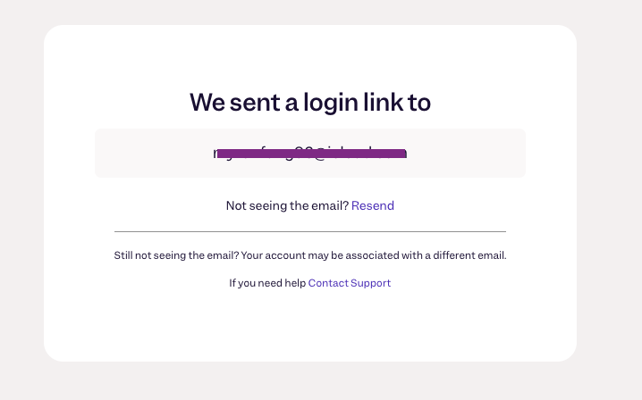
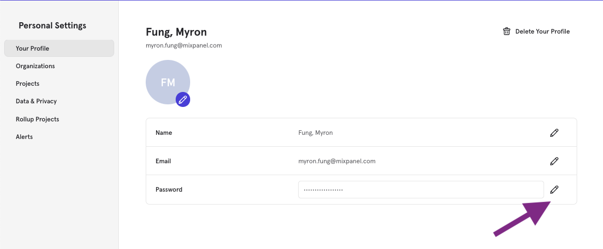
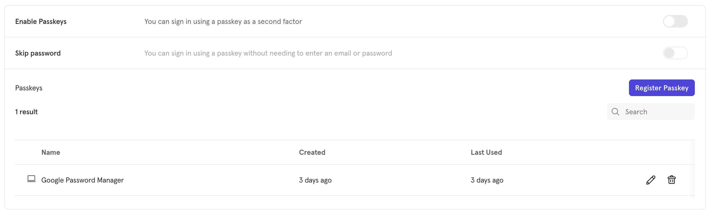
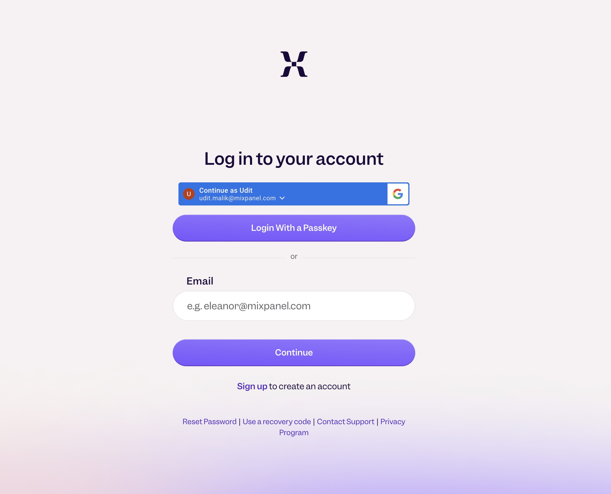

## Overview

Users must authenticate themselves through a login process to access Mixpanel. Mixpanel supports multiple login methods.

## Magic Link Login

<Callout icon="lightbulb" iconType="regular" color="#9a5f12">
  If you do not see the magic link email in your inbox/junk/spam mailbox, you may need to create an account or your account may be associated with a different email address.
</Callout>

By default, Mixpanel users authenticate in a password-less manner using Magic Link. After entering your email and clicking continue in the log in screen, we send an email to your inbox that contains a Magic Link, which will log you in directly.

<Frame>
  
</Frame>

## Password Login

<Warning>
  Once you set a password, the magic link login option will be permanently disabled for your account.
</Warning>

You can set a password for your user account if you prefer to log in by providing an email and password instead of the Magic Link.

To set a password for your account:

1. Click the settings button (gear icon) in the bottom left corner of the UI
2. Select “Personal Settings”
3. Navigate to “Your Profile”
4. Click the pencil icon to set your password.

<Frame>
  
</Frame>

## Passkey Login

Passkeys offer a modern, phishing-resistant way to sign in to Mixpanel without a password. Instead of typing a password or a one-time code, you authenticate with something you already use to unlock your device - Touch ID, Face ID, Windows Hello, or a hardware security key.

Passkeys are built on the WebAuthn/FIDO2 standard. The credential never leaves your device, and it is cryptographically bound to Mixpanel's domain, so it cannot be phished, reused on a fake login page, or replayed by an attacker.

To set a passkey for your account:

1. Click the settings button (gear icon) in the bottom left corner of the UI
2. Select “Personal Settings”
3. Navigate to “Your Profile”
4. Under the Passkeys section, click the "Register passkey" button
5. Follow your device’s prompt to confirm with your fingerprint, face, PIN, or security key

<Frame>
  
</Frame>

Once created, the passkey is immediately available for login. You can optionally enable skip password so Mixpanel uses your passkey as the primary login method, giving you a fully passwordless sign-in experience (this does not bypass org-mandated SSO requirements.)

### Logging in with a passkey

1. On the [login page](https://mixpanel.com/login), click "Login with passkey", or enter your email and continue
2. When prompted, choose to sign in with your passkey
3. Confirm with your device (fingerprint, face, PIN, or security key). You're in!

<Frame>
  
</Frame>

### Recovery codes

When you enable passkeys, Mixpanel generates a set of single-use recovery codes. These let you sign in if you ever lose access to the device that holds your passkey.

<Warning>
  Recovery codes are shown only once. Save them somewhere safe (a password manager is ideal) - Mixpanel cannot show them to you again after this point.
</Warning>

Each recovery code can be used only once. You can regenerate your recovery codes at any time from the Passkeys section of your personal settings; regenerating invalidates the previous set. To sign in with a recovery code, choose the "Use recovery code" option on the login screen and enter one of your saved codes.

## Organization-wide Access Settings

Additional access security requirements may be configured across an Organization that impacts how a user logs in to Mixpanel. Organization Owners and Admins can require users who are inside of their organization to use 2FA, and force any users with an email from a claimed domain to use SSO for login.

**Two-Factor Authentication**: Whenever users sign in with a username and password, they also need to enter a security code generated on their mobile device. Users do not need a security code when signing in through the organization's identity provider (SSO).

**Single Sign-On**: Enable users of your organization to log in with single sign-on. Can also require users to login using SSO and assign roles/permissions via IdP.

Read more about Two-Factor Authentication [here](/docs/access-security/two-factor-authentication) and Single Sign-On [here](/docs/access-security/single-sign-on).

## FAQ

**1. Why am I not receiving the magic login link after I click in?**

Check the junk/spam inbox for the email or click the resend the email from the login page.

If you are not seeing the email even after checking spam and resending the email, it is possible that your account may be associated with a different email. In this case, try signing up for a new account using your provided email. If your account already exists, this is another way to send the magic login link to your email. If your account does not exist, it will create one for you.

**2. Why don't I see my team's data and reports?**

If you signed up via an invitation from a teammate, it is possible that the invitation was sent with the incorrect access permission. Reach out to your teammate and have them follow [these instructions](/docs/orgs-and-projects/roles-and-permissions#invite-users) to grant you access.

**3. I forgot my password. How can I login?**

You can navigate to the [login page](https://mixpanel.com/login/) and click the button at the bottom to set up a new password.

**4. Why do I have to re-authenticate when trying to make important changes?**

We've introduced an additional security layer when making potentially-destructive changes, so you will have to log in again to confirm any of the actions below:

_Your account:_

- Changing your email address or password
- Turning off or resetting two-factor authentication (2FA)
- Adding, removing, or changing passkey settings (renaming a passkey doesn’t require confirmation)
- Deleting your account
- Refreshing your GDPR token

_Organization security:_

- Setting up, removing, or requiring SSO
- Turning on JIT provisioning
- Changing the organization’s 2FA requirement
- Resetting another member’s 2FA
- Changing session settings
- Claiming or changing domains, and opening organization discoverability (closing it doesn’t require confirmation)
- Creating, resetting, or changing the SCIM token or organization name
- Managing admin organizations and trusted identity issuers
- Managing audit-log streams
- Changing the project strong-password requirement

_People and access:_

- Inviting people (by form, CSV upload, or invite link, including regenerating invite links)
- Approving project access requests
- Removing organization members or changing their roles
- Adding people to projects or teams, or changing their project access
- Adding projects to teams
- Creating or changing custom roles
- Transferring a project

_Service accounts:_

- Creating, deleting, or changing service accounts, including adding them to or removing them from projects and teams

_Projects and data:_

- Resetting or deleting a project
- Resetting an API key (for projects that use a legacy API secret)
- Changing the data retention period

_Billing:_

- Cancelling your plan or deleting your organization

**How confirmation works**

- A “Confirm your identity” dialog appears when you try a gated action. Once you confirm, the action goes through. If you close the dialog, nothing changes.
- The confirmation method depends on how you sign in: SSO users confirm with a fresh SSO sign-in, passkey users confirm with their passkey, and everyone else confirms with their password or a 6-digit code sent by email.
- Email codes expire after a few minutes and only work in the browser where you requested them.
