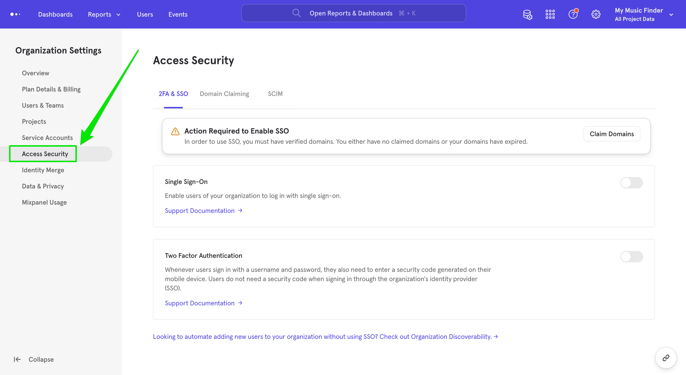
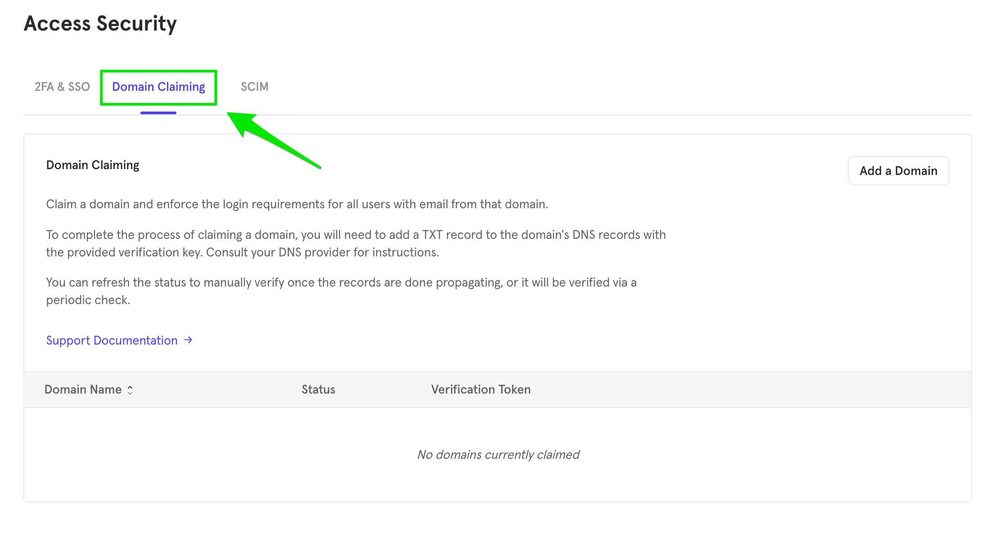
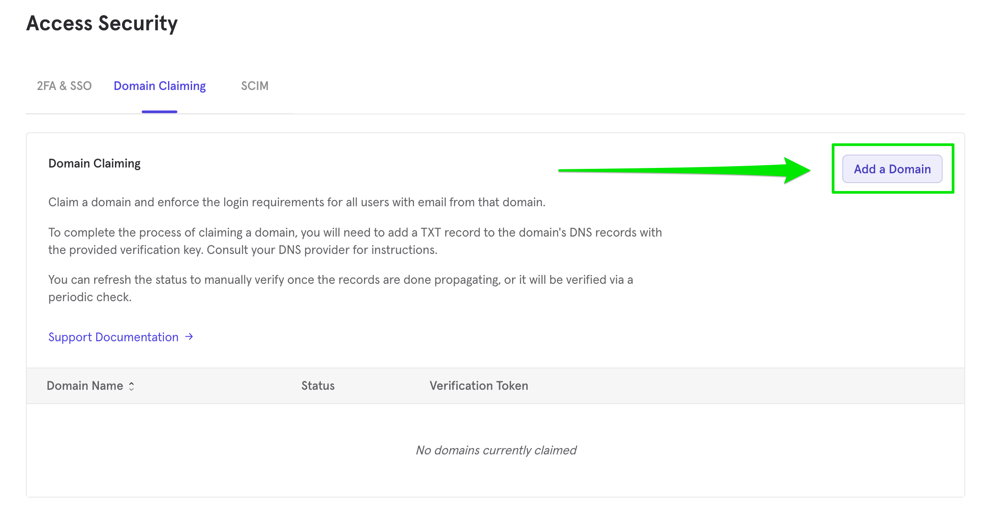
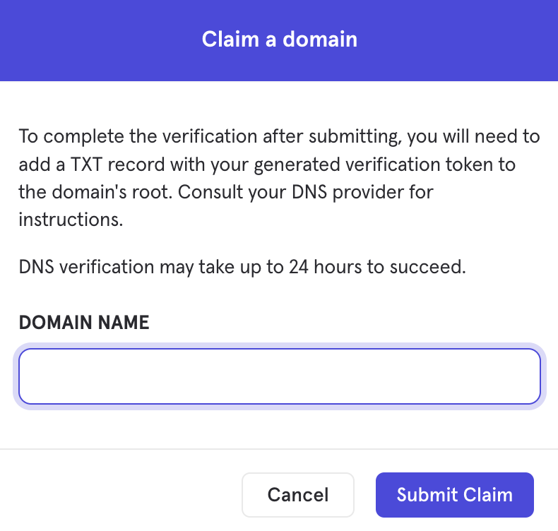
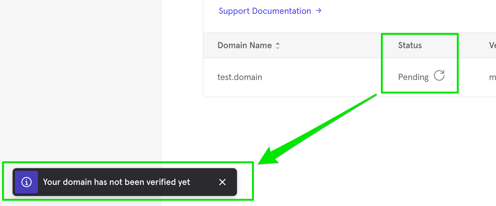
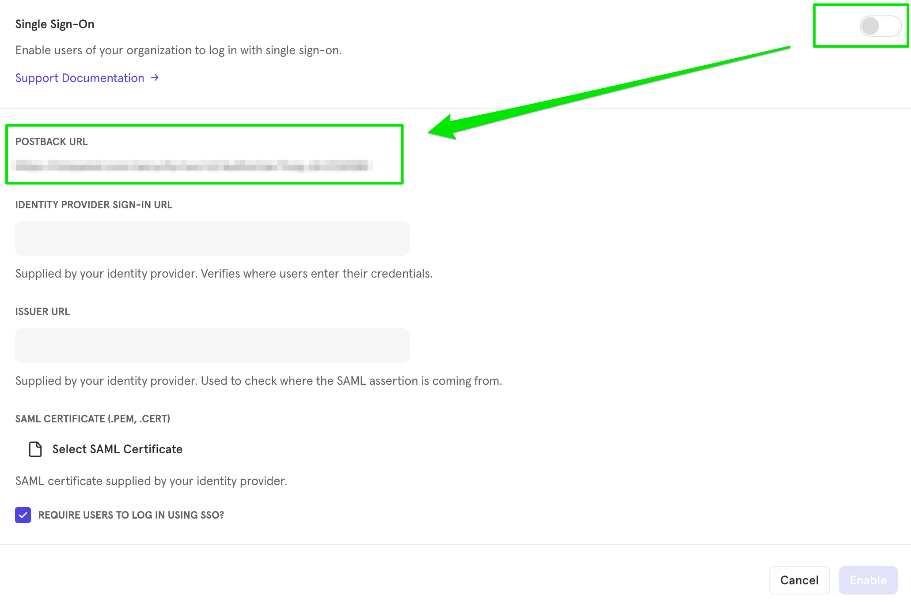
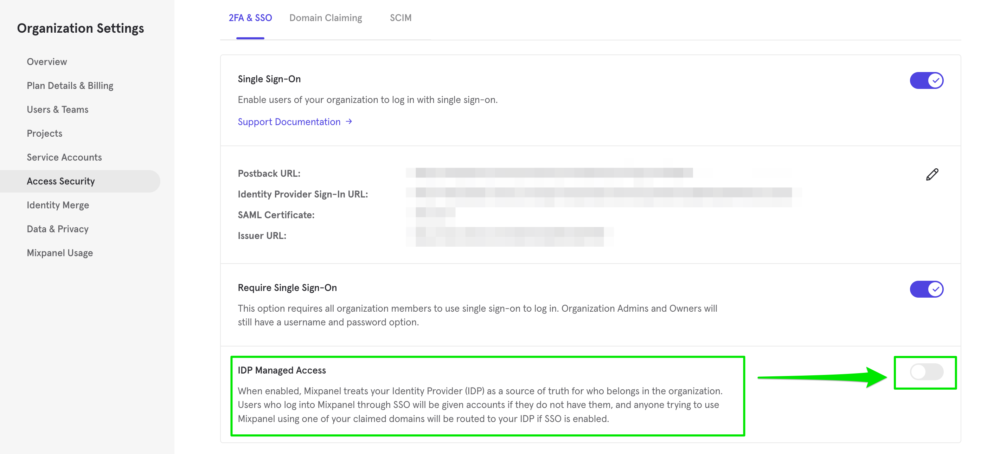
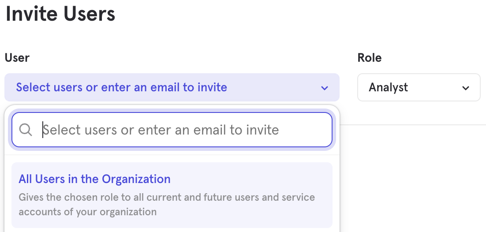
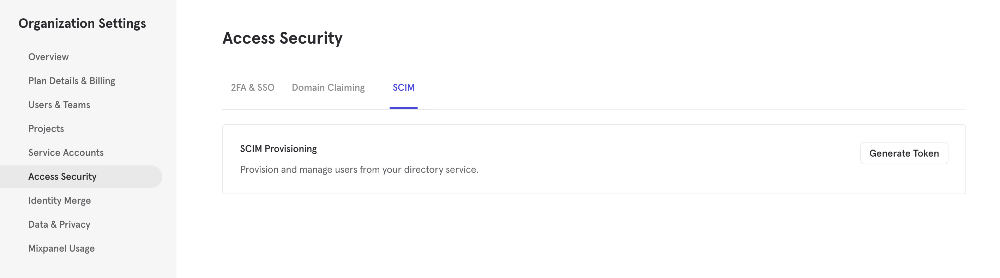
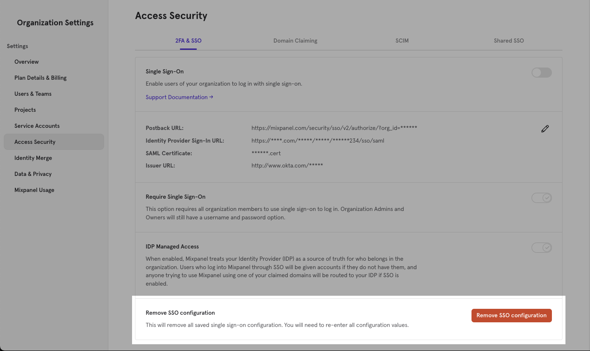

<Note>
  Users on a Growth plan or above can enable Single Sign-On for authentication. SCIM provisioning is available on Enterprise plans. See our [pricing page](https://mixpanel.com/pricing/) for more details.
</Note>

## Overview

Single sign-on (SSO) allows users to log into multiple platforms, services, or systems using a single ID and password combination. Mixpanel supports SSO and works with any SAML 2.0-compliant SSO provider.

## How SSO, IdP Managed Access, and SCIM Fit Together

<Note>
  SSO, domain claiming, IdP Managed Access, and SCIM are all set at the organization level, in **Organization Settings** > **Access Security**, and apply to every project in the organization. Access to individual projects is still granted per project or through Teams. With [Shared SSO](/docs/access-security/single-sign-on/shared-sso), these settings are managed in the Admin Organization and shared by its linked organizations.
</Note>

- **SSO (SAML 2.0)** controls how users sign in. Your identity provider (IdP) authenticates them.
- **[IdP Managed Access](#idp-managed-access)** (with [just-in-time provisioning](#just-in-time-provisioning)) controls who gets into the organization. Users on your claimed domains are sent to your IdP, and anyone who signs in successfully is added as an organization Member.
- **[SCIM](#scim)** keeps users in step with your IdP (it creates, updates, and deactivates users) and maps IdP groups to Mixpanel Teams.
- **[Teams](/docs/orgs-and-projects/roles-and-permissions#teams)** hold project access and project roles, and are managed in Mixpanel.

If you use [Shared SSO](/docs/access-security/single-sign-on/shared-sso) to share SSO settings across several organizations, SCIM maps IdP groups to linked organizations instead of Teams.

|  | SSO only | SSO + IdP Managed Access | SSO + IdP Managed Access + SCIM (Teams) |
| --- | --- | --- | --- |
| **How users join** | An admin invites them in Mixpanel | Added as an Org Member on first SSO sign-in | Provisioned from your IdP when assigned the Mixpanel app |
| **Starting access** | What an admin grants in Mixpanel | No roles beyond what **[All Users in the Organization](/docs/orgs-and-projects/roles-and-permissions#invite-users-to-a-project)** have, plus what an admin grants in Mixpanel | Org Member, plus the projects and roles of any Team mapped from their IdP groups |
| **When someone leaves** | An admin removes them in Mixpanel | An admin removes them in Mixpanel | Deactivated automatically when unassigned in your IdP, if deactivation is enabled in your IdP's provisioning settings |
| **Plan** | Growth and above | Growth and above | Enterprise |

## Setup Steps

<Steps>
  <Step title="Claim and verify your domain">
    [Claim and verify your domain](#claim-a-domain).
  </Step>

  <Step title="Copy your postback URL">
    [Copy your postback URL](#postback-url).
  </Step>

  <Step title="Configure the Mixpanel app in your IdP">
    [Configure the Mixpanel app in your IdP](#set-up-your-idp) (see the provider pages).
  </Step>

  <Step title="Enter your IdP details in Mixpanel">
    [Enter your IdP's certificate, sign-in URL, and issuer URL in Mixpanel](#enter-your-idp-details-in-mixpanel).
  </Step>

  <Step title="Test SSO">
    Test SSO by logging in with a non-admin account.
  </Step>

  <Step title="Optionally require SSO">
    Optionally [require SSO](#require-users-to-log-in-using-sso).
  </Step>

  <Step title="Optionally turn on IdP Managed Access">
    Optionally turn on [IdP Managed Access](#idp-managed-access) (recommended for most organizations). Not available with Shared SSO.
  </Step>

  <Step title="Optionally set up SCIM">
    Optionally [set up SCIM](#scim) (Enterprise plans).
  </Step>
</Steps>

## Access SSO Settings

You will need to be in the **Organization Owner** or **Admin role** to access the SSO settings.

To access SSO settings in Mixpanel, navigate to your **Organization Settings** (gear icon on the bottom-left side of the screen -\> 'Settings' menu), and then click on the **Access Security** tab.

## Claim a Domain

Claiming a domain will add security to an SSO implementation by allowing only members with a claimed domain in their email address to access Mixpanel. SSO only works on domains that are claimed.

To claim a domain, add a TXT record to your domain's DNS records with a verification key provided by Mixpanel. The verification key is available after you submit to claim a domain in your Organization Settings.

Domains are matched exactly against the part of a user's email address after the @. Claiming `example.com` doesn't cover `sub.example.com`. If users have email addresses on a subdomain, claim and verify that subdomain separately, adding its TXT record on the subdomain itself. You don't need to claim subdomains nobody uses for email.

<Note>
  A single domain can be claimed by only one Mixpanel organization. If you have multiple Mixpanel organizations with separate billing accounts but need to share SSO settings and email domains for login, please see the [documentation for Shared SSO](/docs/access-security/single-sign-on/shared-sso) to see how you can share those settings with an "Admin" Organization.
</Note>

### Generate Verification Key by Claiming Domain

To claim a domain, click **Access Security** in your Organization Settings.

<Frame>
  
</Frame>

Click **Domain Claiming** in the Access Security menu.

<Frame>
  
</Frame>

Click **Add a Domain** found in the Domain Claiming sub-menu. You will be prompted to enter your Mixpanel password.

<Frame>
  
</Frame>

Enter the domain you wish to claim in the pop-up modal. Click **Submit Claim**.

<Frame>
  
</Frame>

### Add Verification Token to your DNS

For Mixpanel to verify that you own the domain claimed, Mixpanel must detect the verification token in a TXT record in your domain's DNS.

The verification token is available in the Domain Claiming menu after you claim a domain. Use the verification token in the TXT record that you add to your domain's DNS record.

Add `mixpanel-domain-verify=<your-token>` as the TXT record.

**Note that you will need to leave the verification token in your DNS records permanently**, or the domain will unverify after a week. Only remove the verification token TXT record from domains with which you no longer wish to use SSO.

### Check Verification Status

Verification can take up to 24 hours after you add the TXT record, depending on how quickly your DNS change propagates. Mixpanel checks for the record about once an hour and keeps checking until it finds it. To check right away, click the refresh icon (**Verify Now**) next to the domain in the Domain Claiming menu.

The claimed domain is listed in the Domain Claiming menu. It will appear as pending until it is successfully verified.

<Frame>
  
</Frame>

It will indicate as verified after Mixpanel verifies the domain.

## Postback URL

You likely will need to provide your IdP with a postback URL. The postback URL is accessible from the **Access Security** menu. To obtain your postback URL, navigate to Access Security in your Organization Settings and toggle on the Single Sign-On button.

<Frame>
  
</Frame>

## Set Up Your IdP

You must configure your Identity Provider (IdP) to connect to Mixpanel to use SSO if you are not using custom-built SSO. This requires that you directly configure your SSO settings.

See the supported IdPs below:

<CardGroup cols={2}>
  <Card title="Okta" href="/docs/access-security/single-sign-on/okta">
    Set up SSO with Okta using the "Mixpanel" app within the OIN or by configuring a custom app in Okta.
  </Card>

  <Card title="OneLogin">
    The "Mixpanel" application in the OneLogin application store supports SAML SSO and provisioning. Configure SAML in the app with your [Postback URL](#postback-url), then [enter the certificate and URLs in Mixpanel](#enter-your-idp-details-in-mixpanel). For provisioning, paste a SCIM token from Mixpanel into the provisioning token field in the OneLogin app. [Learn how to generate a token](/docs/access-security/single-sign-on#scim).
  </Card>

  <Card title="Google Workspace" href="/docs/access-security/single-sign-on/google">
    Set up SSO with Google Workspace. There is no auto-provisioning (SCIM) integration with Google Workspace, so you will rely on Just In Time Provisioning, which doesn't map Google groups to Mixpanel Teams.
  </Card>

  <Card title="Azure" href="/docs/access-security/single-sign-on/azure">
    Set up SSO with Azure. Azure also has an auto-provisioning integration with Mixpanel.
  </Card>

  <Card title="JumpCloud" href="/docs/access-security/single-sign-on/jumpcloud">
    Set up SSO with JumpCloud.
  </Card>

  <Card title="Other IdPs" href="https://mixpanel.com/contact-us/support/">
    It is possible to set up Mixpanel SSO with IdPs not listed above. Contact support for further assistance in such cases.
  </Card>
</CardGroup>

## SAML Certificate

Upload your identity provider's (IdP) X.509 signing certificate as a **.cert** or **.pem** file.

- .xml files (such as IdP metadata files) are not valid. Download the certificate file itself from your IdP.
- Mixpanel doesn't issue this certificate or set its expiration. Your IdP does, and the expiry window depends on your IdP and how your SAML app is configured. You can find the expiration date in your IdP's SAML app settings.
- When your IdP rotates to a new certificate, upload the new one in Mixpanel. SSO logins fail until you do. Mixpanel doesn't send a notice before your certificate expires, so track the date in your IdP or set a reminder before it expires.

## Enter Your IdP Details in Mixpanel

On the **Single Sign-On** tab of **Access Security** in your Organization Settings:

1. Upload your IdP's certificate in **SAML Certificate**.
2. Enter your IdP's sign-in URL in **Identity Provider Sign-in URL**.
3. Enter your IdP's issuer URL (entity ID) in **Issuer URL**.
4. Click **Update**.

The [provider pages](#set-up-your-idp) say where to find each value in your IdP.

## Require Users to Log In Using SSO

Optionally toggle on **Require Single Sign-On** to require your users to log in using SSO and to prevent your users from logging in using a username and password.

- Please note that Organization Owners and Admins will still be able to log in using username and password in the case that SSO is not set up correctly.
- Note that external users (with an email of an unclaimed domain) who were invited to projects will _not_ be able to log in if Require SSO is toggled on.

## Require Single Sign-On for administrators
Optionally toggle on **Require Single Sign-On for administrators**; by default, even if the toggle to require SSO is enabled, organization admins and owners can still log in via email+password or magic link. In case you prefer to restrict everyone to use SSO, enable this toggle, and the exception to admins/owners will not apply. Do note that if your SSO is misconfigured, no one with administrator permissions can sign in to fix it, so it's important to verify your authentication is working before enabling.

## IdP Managed Access

This feature determines whether you are using your IdP to manage which users should be allowed in the organization or whether you are using the IdP purely as an authentication method and want to leave user management within Mixpanel.

IdP Managed Access isn't available with [Shared SSO](/docs/access-security/single-sign-on/shared-sso).

If you enable this feature:

- All users of your verified claimed domain(s) who log into Mixpanel will be prompted to use SSO, whether they are in your organization or not.
- If they successfully log in through your SSO setup, they will be automatically added to the organization with no permissions except those granted to all users ([JIT provisioning](/docs/access-security/single-sign-on#just-in-time-provisioning)).
- It will also redirect anyone signing up for a Mixpanel account with your claimed domain or anyone requesting access to a project in your organization to log in via SSO first. This helps ensure all users in your organization who try to use Mixpanel get routed to your IdP, where you can then assign them access to the Mixpanel app. This also prevents needing to manually invite users to Mixpanel from within Mixpanel's Organization Settings.

If this feature is off, users on your claimed domains must be invited to your organization from Mixpanel's Organization Settings.

IdP Managed Access adds users to your organization but never removes them. To deactivate users automatically when they leave, use [SCIM](#scim), or remove them in Mixpanel.

We recommend enabling IdP Managed Access for most customers.

Enable the feature in the Access Security tab of your Organization Settings. Toggle on **IDP Managed Access** at the bottom. The toggle is purple when enabled.

<Frame>
  
</Frame>

### Just in Time Provisioning

Just-in-Time (JIT) provisioning using SAML will let users sign in automatically upon the initial login event. This removes the need for the organization admin to invite individual users to an Organization. JIT provisioning is part of the **IDP Managed Access** feature and is on whenever that toggle is on.

Users added using the IdP will have first names and last names populated by the `firstName` and `lastName` profile attributes provided via SAML at login time. These users will also have no roles to start off except those given to **all users** in your organization.

To give these provisioned users default access to projects, invite **[All Users in the Organization](/docs/orgs-and-projects/roles-and-permissions#invite-users-to-a-project)** to the project.

<Frame>
  
</Frame>

## SCIM

Only accounts with an **Enterprise plan** have access to SCIM at the moment.

SCIM lets your IdP keep users and Teams in Mixpanel in sync. IdPs that currently have an auto-provisioning integration with Mixpanel are [Okta](/docs/access-security/single-sign-on/okta), OneLogin, and [Microsoft Entra ID (Azure)](/docs/access-security/single-sign-on/azure). When you assign users to Mixpanel in your IdP, they will be provisioned in Mixpanel, and optionally, you can deprovision users within Mixpanel who lose access in your IdP.

Users provisioned through SCIM are added to your organization as Members. Organization Roles (such as Owner or Admin) are set for each user in Mixpanel and can't be set from your IdP.

The SCIM menu in the Access Security tab of the Organization Settings lets you generate a token used to hit the SCIM endpoints. **Remember to save this token, as you will see it only once.**

<Note>
  The SCIM endpoint affects only users whose email has a domain in the list of your verified claimed domains.
</Note>

<Frame>
  
</Frame>

If you wish to revoke your SCIM Provisioning token, you can generate a new one, which will kill the previous token.

We recommend enabling **IDP Managed Access** when using SCIM; otherwise, your IdP and Mixpanel can get out of sync.

### Map IdP Groups to Teams

When your IdP pushes a group, Mixpanel looks for a [Team](/docs/orgs-and-projects/roles-and-permissions#teams) with exactly the same name.

- If one exists, the group is linked to it, and the Team keeps its existing project access.
- If none exists, SCIM creates a new Team with that name and no project access. Assign its projects and project roles in Mixpanel.

Group membership in your IdP controls Team membership in Mixpanel. Organization Roles can't be assigned through a Team.

<Warning>
  Deleting the group in your IdP, or unpushing it with the option to delete it, deletes the Mixpanel Team and removes the project access granted through it.
</Warning>

<Note>
  With [Shared SSO](/docs/access-security/single-sign-on/shared-sso), IdP groups map to linked organizations instead.
</Note>

### SCIM API

Mixpanel uses a [SCIM spec subset](https://datatracker.ietf.org/doc/html/rfc7644). The base endpoint is `https://mixpanel.com/api/app/scim/v2`, which you can hit using the SCIM token as an Authentication Bearer token. For instance, a GET call on `https://mixpanel.com/api/app/scim/v2/Users` using the SCIM token will get you a list of all users in your organization.

While you can hit the SCIM endpoints directly, the most common use case is auto-provisioning through an IdP that has an integration with Mixpanel provisioning.

## Troubleshooting

<AccordionGroup>
  <Accordion title="SSO or provisioning fails for a user who already has a Mixpanel account outside your organization">
    Invite them to your organization.
  </Accordion>

  <Accordion title="Users on a subdomain aren't sent to SSO">
    [Claim and verify that subdomain](#claim-a-domain).
  </Accordion>

  <Accordion title="External users can't log in">
    Users with an email on an unclaimed domain can't log in once [Require SSO](#require-users-to-log-in-using-sso) is on.
  </Accordion>

  <Accordion title="SSO logins fail after your IdP rotates its certificate">
    Upload the new certificate in [SAML Certificate](#saml-certificate).
  </Accordion>
</AccordionGroup>

## Remove SSO Configuration

If you need to remove all of your SSO configuration, you can do so with the "Remove SSO Configuration" button. This option is available if you had previously configured SSO and then disabled SSO. This will clear the settings and SAML certificate, as well as entries that facilitate the SSO process.

<Frame>
  
</Frame>

<Warning>
  Removing SSO Configuration is permanent and cannot be undone.
</Warning>
