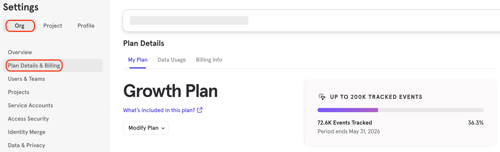
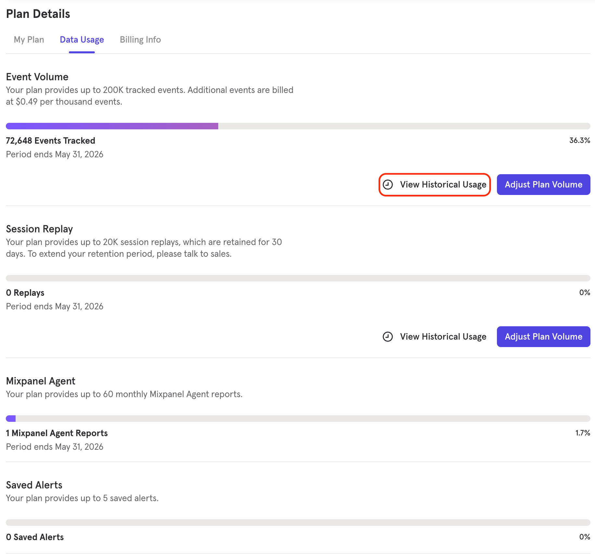
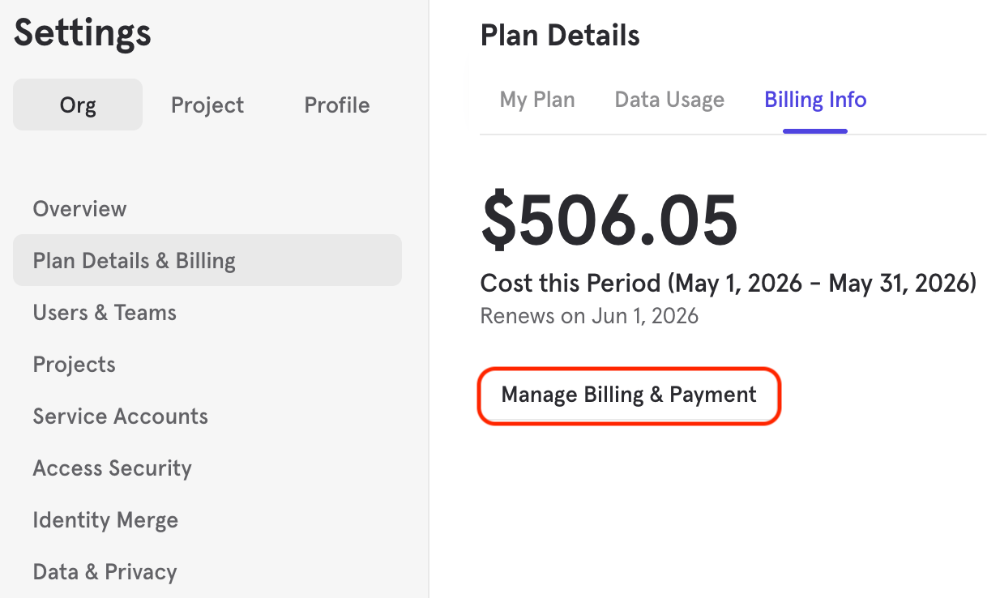
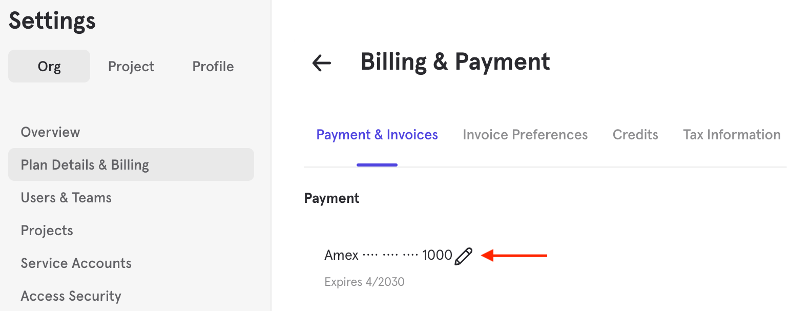
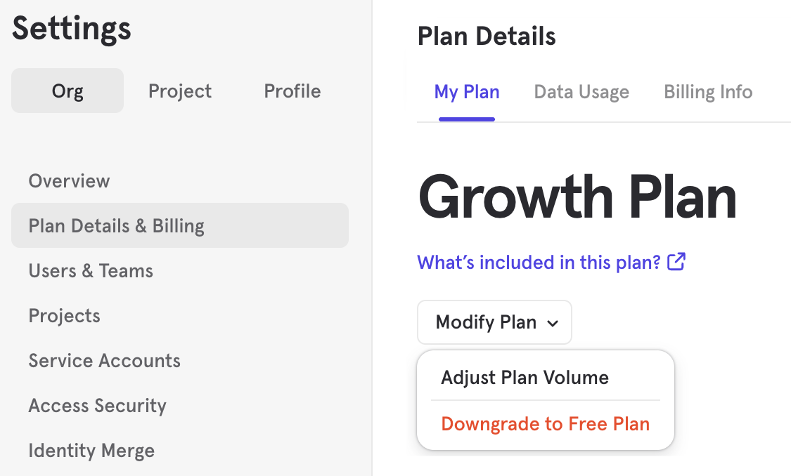

## How Mixpanel Pricing Works

### Events

An event is a data point that represents an interaction between a user and your product. Events can be a wide range of interactions. Here are some examples:

- Social: Post Created, Friend Added
- E-Commerce: Added to Cart, Purchase Completed
- Media: Video Watched, Article Read
- SaaS: Document Created, Call Started

To decide which Mixpanel plan is right for you, first think about [what events you want to track](/docs/what-to-track) and the number of active users you have.

### Computed Monthly Across Projects

Event-based pricing calculates the amount you are charged based on the number of events across all projects in your organization. Certain events and API updates are non-qualifying and **excluded from the Monthly Events calculation**:

- Identify (`$identify`)
- Create Alias (`$create_alias`)
- Merge (`$merge`)
- Opt In (`$opt_in`)
- Session Recording Checkpoint (`$mp_session_record`)
- User profile creation/updates
- Exposure events (`$experiment_started`) covered by your [Experiments usage](/docs/experiments#but-i-am-already-paying-for-exposure-events-in-my-regular-plan-am-i-getting-double-charged)
- Starting with December 2026 usage, exposure events from feature flags that aren't running an experiment, on Growth and Enterprise plans. See [which feature flag exposure events are excluded](/docs/featureflags#do-feature-flag-exposure-events-count-toward-my-monthly-events).

### Plan Differences

There are three event-based billing plans to choose from: Free, Growth, and Enterprise. Optional add-ons are also available, including Group Analytics (recommended for B2B), Data Pipelines (exports your events to a data warehouse or cloud storage bucket), and Metric Trees. Refer to our [pricing page](https://mixpanel.com/pricing/) for more information on the benefits and features of each plan, and for current add-on pricing and plan availability.

The high-level differences between the three are:

- **Free:** Mixpanel is usage-based, and you can use it for free as long as you stay within the plan's limits; no trial needed. If you are new to Mixpanel and want to test it out, we encourage you to use our free plan and upgrade once you have an estimate of your project’s volume. Includes unlimited saved reports and a monthly event allowance. Some features are limited or unavailable on the Free plan; see [our pricing page](https://mixpanel.com/pricing/) for current limits and a full feature comparison.
- **Growth:** The typical Growth plan customer is a small team using Mixpanel (fewer than 50 employees). Growth plans purchased after February 2025 include a monthly allowance of free events; see [our pricing page](https://mixpanel.com/pricing/) for the current amount.
- **Enterprise:** Designed for large teams that need advanced data governance, dedicated onboarding support, and account management. Enterprise also unlocks additional advanced analysis features; see [our pricing page](https://mixpanel.com/pricing/) for a full feature comparison.

All plans include some [Experiments](/docs/experiments) and [Feature Flags](/docs/featureflags) usage, with the option to purchase additional volume on Growth and Enterprise plans. See [Experiments plan availability](/docs/experiments#plan-availability) and [Feature Flags plan availability](/docs/featureflags#plan-availability) for the included amounts.

## Choosing the Right Plan

### How do I estimate how much Mixpanel will cost?

If you're already using another tool, you might have the exact numbers you need. However, if you aren’t using another tool, the best way to estimate costs is to [sign up](https://mixpanel.com/register/) and use our generous free plan. After a week, you'll get a good estimate of your projected volume on your "Plan Details & Billing" page (see below).

### **View Events Usage**

If you are currently tracking data and have either the "Owner" or "Billing Admin" organization role, you can see your events’ consumption in your organization's Settings screen. To do so, click on the gear icon in the lower left corner of Mixpanel, “Organization Settings”, and then the “Plan Details & Billing” tab.

From here, you can quickly view this billing period’s usage on the right side of the screen as well as the historical one by accessing the "Data Usage" tab and clicking the “View Historical Usage” button:

<Frame>
  
</Frame>

<Frame>
  
</Frame>

### Group Analytics Add-On

The Group Analytics add-on enables behavioral analysis at the business or group level, as opposed to the individual level.

Please view the [technical documentation for Group Analytics first](/docs/data-structure/group-analytics), keeping in mind that implementing this feature is not trivial and includes sending your events with the key of the [group](/docs/data-structure/group-analytics/group-analytics-implementation) they belong to. Group Analytics **can’t be implemented retroactively** for already ingested events.

This is a recommended feature for all B2B products that want answers to questions such as:

- What companies are engaging the most with a product?
- In instances with more than one user per account, such as a video streaming service, how are events triggered at an account level?
- What groups convert through a funnel to a goal event (as opposed to what individual users convert)?

For current add-on plan availability, see [our pricing page](https://mixpanel.com/pricing/).

### Data Pipelines Add-On

The Data Pipelines Add-On exports the events in your Mixpanel project to a cloud storage bucket or data warehouse of your choice. It's useful if you want to analyze Mixpanel events using SQL in your own environment. We offer a 30-day free trial of this feature; see the [FAQ](/docs/data-pipelines#how-does-the-free-trial-work) on how to enable it.

For current add-on plan availability, see [our pricing page](https://mixpanel.com/pricing/).

### Metric Tree Add-on

The Metric Tree Add-On enables you to map your growth strategy quantitatively and measurably, and understand the logical relationship between your input metrics and output business outcomes. It is a collaborative space for you and your team to identify opportunities, have prioritization and trade-off discussions across Exec to ICs, and eventually take data-backed decisions. You can read more about the functionality of Metric Trees [here](/docs/metric_tree).

For current add-on plan availability, see [our pricing page](https://mixpanel.com/pricing/).

## Billing & Payment

Mixpanel runs on a subscription service in which your card is charged at the beginning of every month or every year (depending on the plan you purchased) to cover reporting services for that period of time.

<Note>
  This can only be done by "Owner" and "Billing Admin" users. Learn more about [Roles and Permissions](/docs/orgs-and-projects/roles-and-permissions).

  If you don't see these sections, please contact your organization's owner or billing admin. If there isn't one, please [contact the Support team](https://mixpanel.com/get-support).
</Note>

### Update billing information

To update your credit card or download invoices, please follow these steps:

1. Click the gear icon at the lower-left corner of the purple menu at Mixpanel and then the “Organization Settings” option.
2. Then, select the “Plan Details & Billing” tab, and click “Manage Billing & Payment”.

<Frame>
  
</Frame>

### Troubleshoot payment issues

If you received an email or in-app notification that your payment didn't go through, don't worry! It's quick and easy to get back up and running.

1. Click on “Update the Payment Method” in the notification to be taken to your organization's "Billing & Payment" section.
2. Edit the credit card details by clicking the “pencil” icon:

<Frame>
  
</Frame>

3. Lastly, click on the “Rerun Payment” button on the right side.

If the payment is successful, you will see a success message in the bottom left corner, and an error icon should no longer appear next to your payment information - do note that this can take a few minutes to process. You may check back later, and it will not interrupt processing. If you and your bank are unable to resolve the issue, please reach out to our Support team.

### Downgrade your plan to Free

<Note>
  You can only edit or downgrade your plan if you have “Owner” or “Billing Admin” permissions over your Mixpanel organization.
</Note>

<Warning>
  Downgrading to the Free plan does not take effect immediately. You will keep your current plan through the rest of this billing cycle, and the Free plan starts on your next billing date.
</Warning>

To submit a downgrade request:

1. In your organization's “Plan Details & Billing” tab, click "Modify Plan", and then "Downgrade to Free Plan".
2. A pop-up window will appear, informing you that your account will remain active and be automatically moved to a Free plan after your current monthly/annual subscription ends.
3. After clicking the "Submit" button, a Downgrade Request Email is sent to all organization owners as proof of your request, and a copy of it goes to Mixpanel's Billing Team for processing.

<Frame>
  
</Frame>

## FAQs

### How do I reduce my Mixpanel bill?

The best way to reduce your bill is to send fewer events to Mixpanel. Check your project’s [Lexicon](/docs/data-governance/lexicon#viewing-query-volumes-for-events-and-properties) for events you are not querying, or for events with few queries and a high volume not providing value.

You can also check the top events contributing towards your event count by creating a monthly Insights report querying “All Events” with a breakdown by “Event Name” ([example](https://mixpanel.com/project/3018488/view/3536632/app/insights#J1ZGYyVkWKpK)).

[Hiding events](/docs/data-governance/lexicon#hide-events-and-properties) in Lexicon won’t stop their ingestion. [Dropping an event](/docs/data-governance/lexicon#dropping-events) in Lexicon will only block its ingestion from the moment it was dropped, not removing it retroactively.

### What if I go over my event plan allowance? Do you stop tracking my events?

If you go over your plan's events, Mixpanel won't stop collecting your data:

- If you’re using a Free plan, Mixpanel won’t stop collecting your data, but querying is paused once you go over the Free plan’s monthly event limit. The pause stays in place until you upgrade to a Growth plan. Growth plan pricing depends on the event allowance and add-ons you choose (see [our pricing page](https://mixpanel.com/pricing/)), and requires a credit card. Your Growth plan starts from the first of the current month, so all of this month’s events count toward its allowance, and any events above it are billed at your plan’s cost per event on your next invoice.
- If you’re using a Growth plan, events above your plan are billed at the beginning of the next month at the same cost per event as your plan; you can find your rate in the "Plan Details & Billing" section in your Organization Settings. If you want to avoid paying for additional events, you can either [downgrade your paid plan to the Free one](/docs/pricing#downgrade-your-plan-to-free) or upgrade to a plan that covers your usage before the end of the billing cycle. See [our pricing page](https://mixpanel.com/pricing/) for details.

#### Alerts for Additional Data Charges

Organization owners and billing admins are sent an alert email if their account reaches the following percentages of their plan volume: 85%, 100%, 110%, 120%, 200%, 300%, and 400%. If an account reaches two or more of these thresholds, it is possible to receive multiple alerts in one month. Additionally, email addresses that are CC'd on invoice receipts will also be CC'd on alert emails.

#### Can I set a billing limit?

While it's not possible to set a billing limit at this moment, read [this article](https://github.com/orgs/mixpanel/discussions/526) to learn how to create a report and get warning alerts when you’re close to exceeding your plan limit.

### I signed up for the lowest-volume Growth plan. What happens if I go over that amount?

Events within your plan’s free monthly allowance are free! If you go over your plan’s event volume, each additional event is charged at the same cost per event as your plan, which you can see in the “Plan Details & Billing” section in your Organization Settings. Larger plans include volume discounts, so purchasing a higher volume upfront lowers your cost per event. For current pricing, see [our pricing page](https://mixpanel.com/pricing/).

If you have add-ons such as Group Analytics or Data Pipelines, they can also affect what you're charged for additional data. For current add-on plan availability, see [our pricing page](https://mixpanel.com/pricing/).

As an example:

- You signed up for the lowest-volume Growth plan
- If you send 10% more events than your plan includes in a month, you’ll be charged for those extra events at your plan’s cost per event.

We bake volume discounts into our pricing, so if you are often tracking more events than your plan includes, it may be better to upgrade to the right-sized plan on the Pricing page — you’ll pay less per event.

### Is Mixpanel’s pricing based on MTUs?

Mixpanel’s default pricing option is based on events because it is a better option for the majority of customers. Mixpanel also offers an MTU-based Enterprise plan. If you are interested in learning more about it, [contact our sales team](https://mixpanel.com/contact-us/sales/).

If you are an existing customer on an MTU plan, [refer to our MTU Pricing Guide](/docs/pricing/legacy-mtu-billing).

### Are monthly events calculated based on ingestion time or event timestamp?

Events are calculated based on the ingestion time, defined as the time an event is processed by Mixpanel servers. Ingestion time is [stored by default](/docs/data-structure/property-reference/default-properties#event-properties) as the Time Processed (UTC) property on all events. For example, if on January 10th an event is sent to Mixpanel that is timestamped December 10th, it will be included in January's monthly tallies.

Some accounts are on legacy event timestamp billing. In this case, monthly events are tallied based on the timestamp of the event. For example, if on January 10th an event is sent to Mixpanel that is timestamped December 10th, it won’t be included in any tallies because the timestamp is from a previous month.

You can see if your account is on ingestion time billing in Organization Settings \> Plan Details & Billing \> Data Usage.

### Is old event data billed when imported to Mixpanel?

This depends on whether your account is on ingestion time or event timestamp billing. Refer to the section above for details.

For accounts on ingestion time billing, old events will be included in billing tallies since they’re calculated based on ingestion time. For example, if April 1st - April 30th is the current billing cycle, importing data from March **will** be included in the April event count. If you’re planning on backfilling a significant amount of historical events and need help understanding how it will impact your costs, please reach out to your Mixpanel account manager or [contact support](https://mixpanel.com/get-support).

For legacy accounts on event timestamp billing, events imported with timestamps outside the current billing cycle will not contribute to event tallies. For example: if April 1st - April 30th is the current billing cycle, importing data from March will **not** be included in the April event count.

### I use warehouse connectors to ingest data. How does this impact billing?

Events imported through a warehouse connection are treated as any other source (same as importing through our SDKs or API directly). Warehouse data, similar to other sources, is billed in accordance with general Mixpanel pricing policies.

There is one additional field you will see in the Billing Page on your Data Usage Table called "Updates". Updates (updating an existing event or deleting an event) are generated by Mirror-type syncs and are tracked separately from event volume. Updating an existing event is counted as two events towards billing (a delete of the old event and an insert of the new event), and they are counted and billed for the month they were triggered on, even if the record being updated is for a previous month. You can read more about these updates and how warehouse connectors may affect billing from the warehouse perspective [here](/docs/tracking-methods/warehouse-connectors#faq)

### I received an email asking me to upload my company's tax information. Is it a scam? Why are you asking for that?

Those emails are real and part of our ongoing efforts to ensure that our customers' billing and tax data is as up-to-date as possible. This allows us to generate invoices with the correct information and helps reduce billing issues.

To do so, you can either use the link provided in the email or go to your organization's Settings -\> 'Plan Details & Billing' tab -\> 'Billing Info' tab -\> 'Manage Billing & Payment' button -\> 'Tax Information' tab -\> 'Manage Tax Info' button on the top-right side of the screen.

If you or your Finance team have any additional questions about it, please [contact the Support team](https://mixpanel.com/get-support).
