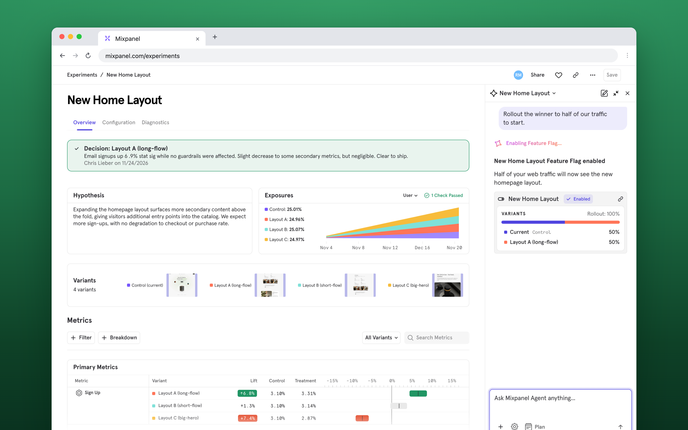

import {FrameColumn} from "/snippets/FrameColumn.jsx";

Your team can ship faster than ever. The hard part is knowing which changes actually help before every user gets them. Experiments let you try a change on part of your audience first and measure it against the numbers you already track.

This guide covers what to test, how to set up a test you can trust, and what to do with the result.

## Why experiment in Mixpanel

Most teams start from one of two places.

**You're not testing yet.** Changes reach every user before anyone knows whether they work. Engineering time goes to features that don't move anything, and a change that hurts conversion can sit in production for weeks before someone notices.

**You're testing in another tool.** Each test means a separate setup, metrics rebuilt to match what you report in Mixpanel, and results that don't quite agree with your dashboards. Tests are slow to set up, so you run fewer of them and guess more often.

Either way, when a number moves after a release, it's hard to tell whether your change caused it or what else it affected.

Experiments in Mixpanel close that gap by running on the data you already have, so every team works from one set of numbers.

<CardGroup cols={3}>
  <Card title="Built into every release" icon="sparkles">
    Ask [Mixpanel Agent](/docs/mixpanel-agent) to set up an experiment on your cohorts and metrics, then review it before launch. For website copy and layout, [Web Experiments](/docs/experiments/no-code-experiments) lets you test an idea without code.
  </Card>

  <Card title="Target the right users" icon="bullseye">
    Target experiments by what users do, using cohorts you already track. Roll them out on [Feature Flags](/docs/featureflags) so you decide who sees a change.
  </Card>

  <Card title="See what changed, and why" icon="magnifying-glass-chart">
    Results sit next to the rest of your data. Open any metric in a report, then watch [Session Replay](/docs/session-replay) to see what people did differently.
  </Card>
</CardGroup>

<Info>
  Already testing with another tool or an in-house system? You can [send its exposure events to Mixpanel](/docs/experiments#implementation-for-experimentation) and analyze those tests in Mixpanel too. To fully migrate flags and experiments over from another tool, see the [migration playbook](/guides/strategic-playbooks/feature-flag-migration-playbook).
</Info>

Want to see it first? This 3-minute overview shows how experiments work in Mixpanel.

<FrameColumn src="https://www.youtube-nocookie.com/embed/LZfIPCXcIPE" title="Mixpanel Experiments" description="In this 3-minute overview, see how to set up an experiment on the data you already track and read what changed." link="https://youtu.be/LZfIPCXcIPE" />

## What teams test

If you're not sure where to start, most experiments fall into one of a few situations. Pick the one closest to what's on your roadmap right now.

- **Improve an AI agent.** You're about to change the model or the prompt behind your agent. Test the new version against the current one and compare whether users come back for more conversations, before everyone gets the change.
- **React to a drop or a problem.** A funnel step dips, or user feedback points to friction. Once you have a likely cause, test a fix on part of your traffic so you know it worked, rather than assuming it did. [Root Cause Analysis](/docs/root-cause-analysis) and [Alerts](/docs/features/alerts) can help you find the problem in the first place.
- **Put data behind an idea.** Someone on the team is sure a new feature or flow will help. Test it on a slice of users before committing more engineering time to it.

<Info>
  Testing copy, colors, or layout on your website? You can build those changes without code. See [Run web experiments that give you clear answers](/guides/guides-by-use-case/grow-your-usership/run-web-experiments).
</Info>

## Run experiments you can trust

An experiment is only useful if you believe its answer, and most unreliable answers trace back to choices made before launch. Settle these four things first.

### Turn a hunch into a prediction

Write it as _If [change], then [result], because [reason]._ Then add one more line: the result that would make you drop the idea. If no outcome would change your mind, the test isn't worth the traffic. See [plan your experiment](/docs/experiments#plan-your-experiment).

### Measure close to the change

Choose a success metric your change can plausibly move while the test runs. A new onboarding screen should move activation, not annual revenue, which reacts too slowly and to too many other things to tell you much. Add guardrails for what the change could hurt elsewhere. See [choose success metrics](/docs/experiments#step-3-choose-success-metrics).

Keep the change on its own flag rather than bundled into a bigger release. When five changes ship together and a number moves, you're left guessing which one did it.

### Size it before you build it

How long a test takes depends on your traffic and how big a change you expect. Check this before engineering builds anything. If the [Sample Size Calculator](/docs/experiments#sample-size-calculator) says it will take months, test a bolder version, or test earlier in the flow where more users pass through. Pick your [model type](/docs/experiments#experiment-model-types) at the same time, based on whether you need to check results early.

### Agree on the decision rule up front

Decide with your team what result means ship, what means don't ship, and who makes the call. Writing it down before launch keeps the decision from bending toward whatever the numbers show.

Once the test is live, don't change metrics or settings to rescue a result. If something is genuinely broken, [restart the experiment](/docs/experiments#restarting-or-resetting-an-experiment). And if one segment looks like a winner after the fact, treat it as the idea for your next test, not a result to ship. See [the risk of post-hoc segmentation](/docs/experiments#the-risk-of-post-hoc-segmentation), and for reading results, [interpret your results](/docs/experiments#interpret-your-results).

## Try it: Plan an experiment on one page

Before anyone builds, fit the whole plan on one page. Here's what that looks like for a common feature experiment: shortening onboarding.

| Decision | Example |
| --- | --- |
| Prediction | If onboarding drops from three screens to two, more new users will activate, because they'll reach the product before they lose interest. |
| What would change your mind | Activation stays flat or drops over the planned run. |
| Success metric | Activation, using the definition your team already reports on |
| Guardrail | Share of new users who finish setting up their profile |
| Who sees it | Half of new users, on a feature flag |
| How long | Whatever the Sample Size Calculator says your traffic needs |
| Decision rule | Ship if activation is clearly up and profile completion holds. The product lead makes the call. |

With the plan agreed, [create the experiment](/docs/experiments#step-1-select-an-experiment) or ask [Mixpanel Agent](/docs/mixpanel-agent) to set it up from your plan: "Set up an experiment testing a two-screen onboarding flow against the current one, measured on activation." Review what it creates before launch.

**When the result comes in**, it will land in one of three places:

- **A clear win.** Ship the two-screen flow, then keep an eye on your guardrails for a few weeks. See [what to watch after rollout](/docs/experiments#what-to-watch-post-rollout).
- **A clear loss.** Keep the current flow. Your "because" was wrong, which is worth writing down so the idea doesn't resurface untested.
- **No clear difference.** Keep the result inconclusive unless the data rules out the improvement you planned to detect. If there aren't enough users to answer that question, collect more data or rerun the test. Watch a few [session replays](/docs/session-replay) from each version to find ideas for your next prediction.

## Build on every result

One test answers one question. A steady run of them changes how your team decides what to build, but only if the results get used.

- **Record why you decided, not only what.** When you log a decision on an experiment, add a note on your reasoning. Six months from now, "shipped because activation rose and nothing else dropped" is far more useful than a green checkmark.
- **Put results where people already look.** [Add experiments to a Board](/docs/experiments#experiments-on-boards) next to the reports your team checks each week, so results don't disappear into one person's tab.
- **Share the losses too.** A test that didn't win still told you something. Teams that only share wins learn to avoid risky ideas. Teams that share everything learn faster.
- **Make it routine.** Give experiments two or three minutes in a recurring team meeting: what launched, what finished, and what you'll test next. Momentum comes from cadence more than from any single big win.

Teams that work this way see the difference. Step tested a redesigned flow to guide new customers toward setting up direct deposit and saw a 14% lift in customers receiving a recurring direct deposit within 30 days. [Read the Step story](https://mixpanel.com/customers/how-step-boosted-direct-deposits-by-14-with-mixpanels-experimentation/).

## Next step

<Card title="Start with one experiment" icon="flask" href="/docs/experiments" cta="Learn more">
  Pick one funnel and one test. Then use the Sample Size Calculator to choose how long to run it. Every plan includes some Experiments usage, so you can run your first test on the data you already have.
</Card>
