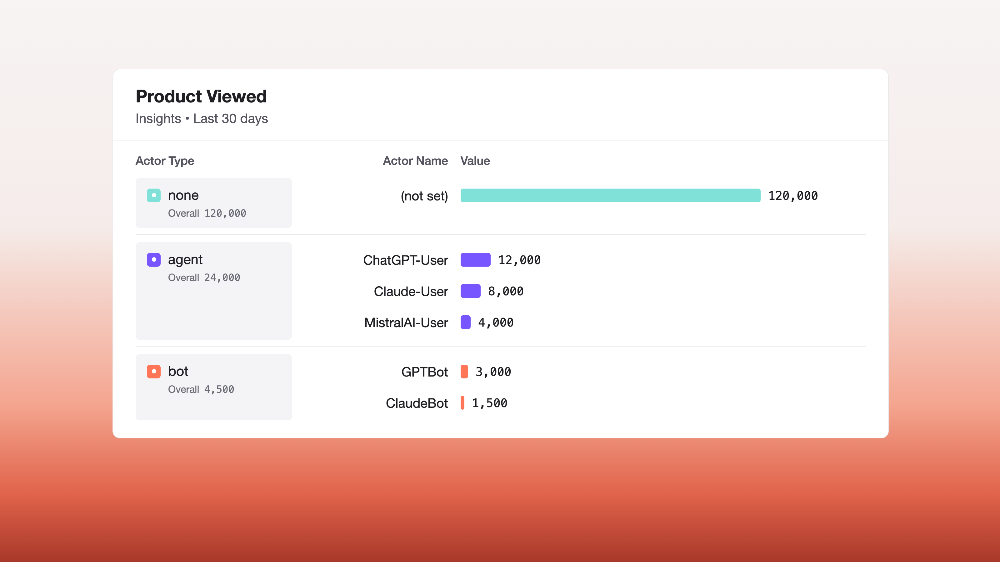
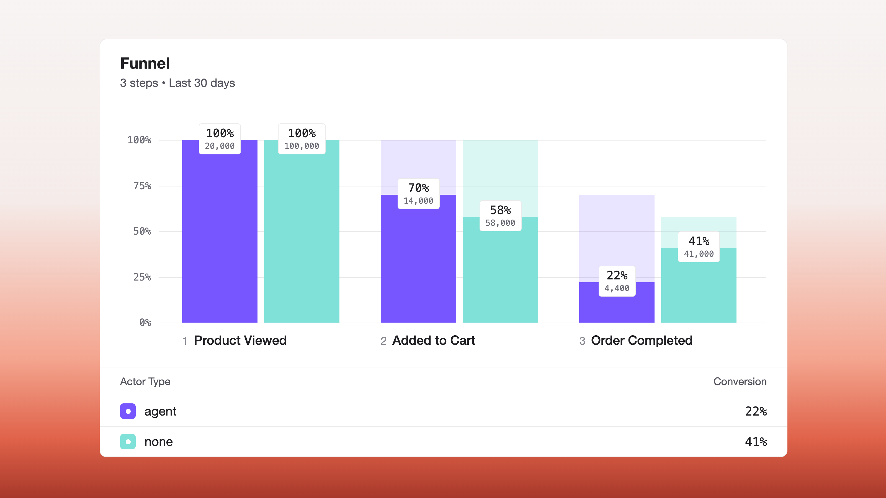

Your traffic isn't only people. Bots and crawlers have long been part of the traffic to your website or app. But now, AI agents are increasingly doing real tasks for real customers: comparing, booking, buying, and signing up on someone's behalf. Depending on how you filter automated traffic, agents may be filtered out with it.

This guide covers how to identify agents and bots in your event traffic, define success for an agent, and compare agent and likely human behavior in the reports you already use.

<Info>
  New to thinking of agents as users? [Start treating AI agents like first-class users](https://mixpanel.com/blog/treat-ai-agents-like-first-class-users/) explains how agents behave in products and how fast their traffic is growing.
</Info>

## Why measure agents in Mixpanel

Most teams start from one of two places.

**You filter automated traffic.** Depending on how you filter, an agent buying for a customer can be removed along with a crawler indexing your catalog. When that happens, you can't see how much of your product agents use, or where they get stuck.

**You've never looked.** Agent activity is mixed into your numbers. A conversion rate or a funnel drop-off may be partly an agent's doing, and you can't tell.

Either way, agents aren't being measured on their own terms, and measures built for people don't always translate. Mixpanel classifies events as agent, bot, or neither, so you can analyze agents with the reports you already use.

<CardGroup cols={3}>
  <Card title="Tell agents from bots" icon="robot">
    Mixpanel classifies events by Actor Type. Exclude the bots, keep the agents.
  </Card>

  <Card title="Define success for agents" icon="bullseye">
    Track completion rate, steps to success, and time to convert instead of time on site.
  </Card>

  <Card title="Use the reports you have" icon="chart-simple">
    [Break down](/docs/reports#breakdowns) any report by Actor Type. Compare funnels, event mix, and conversion for agents and people side by side.
  </Card>
</CardGroup>

<Info>
  This guide covers agents that show up to use your product. If you've built an agent into your product and want to measure how it's doing, start with [Agent Intelligence](/docs/agent-intelligence).
</Info>

## Three habits for measuring agents

These three habits take you from raw traffic to a clear picture of what agents do in your product, so you can fix what's getting in their way.

### Tell agents apart from bots

You may see automated traffic described as traditional bots, AI crawlers, and AI agents. Mixpanel sorts it into two classifications, bot and agent.

Mixpanel's ingestion APIs classify the user agent of each event and set the following [default event properties](/docs/data-structure/property-reference/default-properties#event-properties):

- `$mp_actor_type` (Actor Type): `agent` for requests from an LLM acting on behalf of a human user (e.g. ChatGPT or Claude Code), `bot` for generic automated traffic such as crawlers and search indexers, and `none` when neither applies.
- `$mp_actor_name` (Actor Name): the classified identity behind an `agent` or `bot` actor type, such as `GPTBot`, `ClaudeBot`, or `MistralAI-User`. Only present when the actor type is `agent` or `bot`.
- `$mp_raw_user_agent` (Raw User Agent): the raw user agent associated with the request.

Break down a report by Actor Type to see how much of your traffic comes from AI agents and bots, or by Actor Name to see which ones.

To exclude only bots, set the filter to Actor Type is not `bot`. Events tracked before classification was available have no Actor Type and appear as `(not set)`, so excluding `bot` (rather than filtering on `none`) keeps them in your reports. If you already filter automated traffic another way, check whether it removes agents too.

If you don't send the end user's user agent as `$mp_raw_user_agent` or `$mp_user_agent`, classification uses the user agent of the request that reached Mixpanel. With server-side tracking, that is your server's HTTP library, so classification can be inaccurate. If you track server-side, forward your end user's raw user agent as `$mp_raw_user_agent` or `$mp_user_agent`. See [Tracking Browser, Device, and OS](/docs/tracking-best-practices/server-side-best-practices#tracking-browser-device-and-os).

<Info>
  If you want to block bots at ingestion, review [how Mixpanel handles unwanted traffic](/docs/tracking-best-practices/bot-traffic).
</Info>

### Define success for an agent

Time on site means different things for people and for agents. A long visit can mean interest from a person and trouble for an agent. An agent is after one thing, the information or action it was sent for, so it rewards pages that make that easy to find. That means a measure that signals success for people can signal a problem for agents.

Pick the event that marks success for the task, like Order Completed or Account Created, and use the same event for people and agents. Then track three things for agents:

- **Completion rate.** What share of agents reach the event.
- **Steps to success.** How many events it takes to get there.
- **Time to convert.** How long it takes. Shorter usually means the agent found what it needed.

<Tip>
  Write down what you expect before you look. If you guess after seeing the numbers, it's easy to explain whatever you find.
</Tip>

### Compare agents and people side by side

Build a [funnel](/docs/reports/funnels/funnels-overview) from first touch to your success event, then break it down by Actor Type. Look at four things: where each group drops off, how long conversion takes, how much activity each group generates, and which events agents fire that people rarely do, or the other way around. The last one shows you which parts of your product agents lean on most.

Count activity both in total and per user, since the two can tell different stories. A spike in agent activity also affects more than your reports, so it's worth watching how your product holds up.

Some experiences involve both: An agent researches, then a person finishes. When both sit in the same funnel, [property attribution](/docs/reports/funnels/funnels-advanced#property-attribution) controls which step's Actor Type labels the whole funnel.

Read drop-offs carefully. An agent that adds to cart and stops may be comparing options for a person. An agent that stops at payment may be handing off to a person or hitting a problem, so look closer before you decide. To dig into a drop-off, break that step down by properties you already track, such as page or error message.

<Tip>
  Break down by Actor Name as well. Different agents behave differently, and an average can hide the one that's getting stuck.
</Tip>

## Try it: Compare how agents and people check out

Here's how the habits come together on a common question for an ecommerce product: Do agents finish checkout as often as people, and where do they stop?

| Report setup | Example |
| --- | --- |
| Success event | Order Completed |
| Funnel | Product Viewed, Added to Cart, Order Completed |
| Breakdown | Actor Type first, then Actor Name |
| Filter | Start with all three groups side by side. Then exclude bots to focus on agents and people. |

Build the funnel and break it down by Actor Type. Then compare conversion at each step and time to convert. You can also ask [Mixpanel Agent](/docs/mixpanel-agent): "Show me the funnel from Product Viewed to Order Completed for people and agents." Review what it builds before you rely on it.

**When the comparison comes in**, it could lead to learnings such as:

- **Agents drop at the same step as people.** The friction isn't specific to agents. Fix it once and both groups benefit.
- **Agents drop at a step people clear easily.** Break that step down by Actor Name and by properties like page or error message. The page may rely on visuals, or an error may not explain what to do next.
- **Agents convert as often as people, but faster or slower.** Check whether the gap makes sense for the task before treating it as good or bad.
- **Agents convert more often than people.** That's a good sign for how your product works for agents. Check that your success event means the same thing for both groups before you celebrate.

## Make the call on what you find, and keep watching

Agent traffic is changing quickly, so a baseline you set now is worth more than a perfect analysis later.

- **Save the funnel to a [Board](/docs/boards).** Keep it next to the reports your team already checks, so agent behavior doesn't live in one person's tab.
- **Take drop-offs to the team that owns the page.** A drop-off at one step is a specific, fixable request for whoever owns that step.
- **Rerun the funnel after every release.** If agents and people need different measures, you can't tell whether a release was worth it until you can see them separately.

## Next step

<Card title="Break down your top funnel by Actor Type" icon="magnifying-glass-chart" href="https://app.mintlify.com/mixpanel-edb78807/mixpanel-edb78807/editor/amy%2Fdraft-nov-24/~/44b5c9b5-6a24-4c9b-a13f-b886739a229d#breakdowns" cta="Learn more">
  Pick the funnel closest to revenue and add Actor Type as a breakdown. It takes seconds, and you'll see how much of that funnel agents already use.
</Card>
