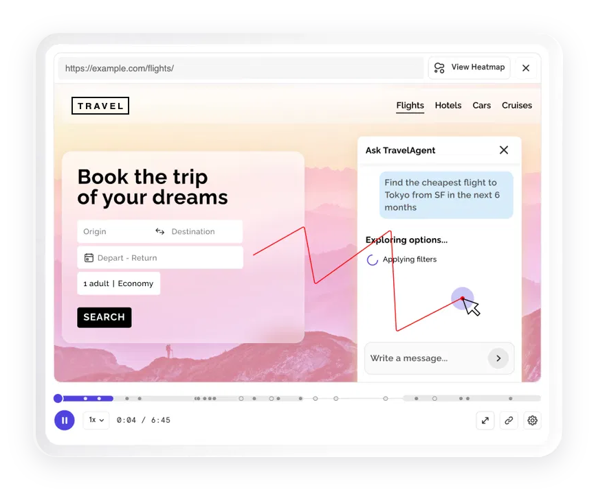
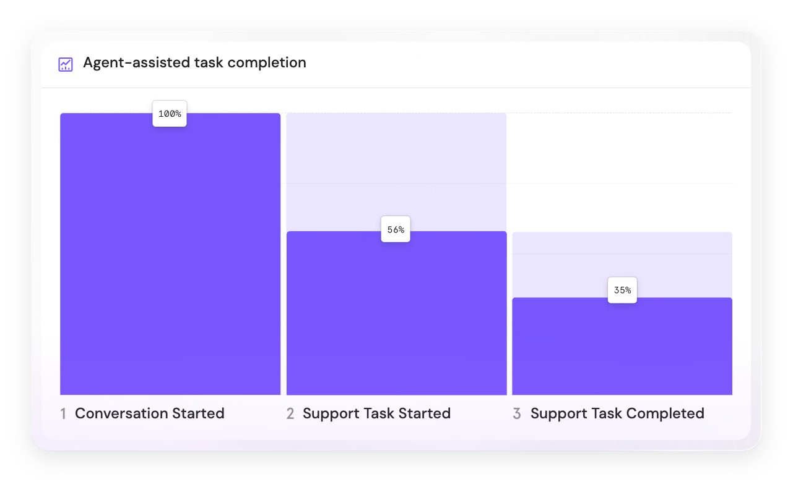
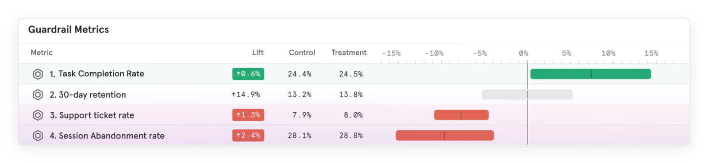

You shipped an agent, and customers are using it. The usage numbers look fine. What they don't show is whether the agent helped. Did those customers get what they came for, stay, or give up?

{/* IMAGE 1: Existing Session Replay graphic of a customer asking an AI agent for help on a website (the "Ask TravelAgent" example). Crop to the replay window and leave out the replays list, which shows 2023 dates. Upload as /images/assess-agent-session-replay.png, then replace this comment with:
   */}

If you're a product leader, product manager, or analyst at a company where product usage drives revenue, you can answer that with [Agent Intelligence](/docs/agent-intelligence) and the Mixpanel reports you already use.

You can follow along with this guide whether or not you've sent agent data to Mixpanel yet. It helps to know which outcome you want the agent to move, like a completed support task, an order, or a finished onboarding.

If conversation, turn, or span are unfamiliar terms, see [Concepts](/docs/agent-intelligence#concepts).

## Assess your agent in five steps

A dashboard can't tell you whether an agent is delivering the outcomes you care about. These steps can.

You'll find out whether your agent helps customers reach the outcome you care about, what each of those results costs you, and how that cost compares with the value of each result. Then you'll know what to do next.

<Steps>
  <Step title="See why the usual numbers mislead">
    Learn which dashboard numbers to treat with caution and what to check instead.
  </Step>
  <Step title="Choose the outcome to measure">
    Name what the agent is meant to move, so every comparison has something to measure.
  </Step>
  <Step title="Compare customers fairly">
    Set agent users against similar customers who didn't use the agent.
  </Step>
  <Step title="Work out cost per outcome">
    Find what each outcome costs, and how that compares with the value of an outcome.
  </Step>
  <Step title="Put it together">
    Weigh what you found against what's still uncertain, then decide your next move: scale the agent, test it, fix it, or rethink it.
  </Step>
</Steps>

Together, these steps replace a pile of usage numbers with a clear basis for your call. An agent can look busy and still fail customers, or look expensive and still deliver the outcomes you want.

## Why the usual numbers mislead

Most agent dashboards count activity. Activity is easy to measure, and it can point the wrong way. Four numbers show up on most of them, and each one is worth a second look.

**Conversation volume.** A busy agent isn't always a helpful one. Check whether those customers reach your outcome.

**Prompts per conversation.** A long exchange could mean a customer is getting real help, or that they're stuck and asking again in different words. Open the conversations behind the number.

**"Resolved" rate.** A chat marked resolved can still come back as a ticket or a cancellation. Check what customers do after the chat.

**Cost per conversation.** A cheap conversation that ends with nothing is still a loss. Look at cost per outcome instead.

## Choose the outcome to measure

Every agent is built to move something. Before you compare anything, name that outcome, and make sure it's an event you can count in Mixpanel. The outcome is what the customer did, not what the agent said.

Here's how that looks for a few kinds of agent:

| Agent type | Outcome to measure |
| --- | --- |
| Support agent | Support task completed, with no repeat contact |
| Onboarding or account-setup guide | Onboarding completed |
| Booking or trip-planning agent | Booking made |
| In-product copilot | Feature adopted, or customer retained |
| Shopping assistant | Order completed |

## Compare customers fairly

When your agent sends a matching user ID, Agent Intelligence ties each conversation to the same customer as the rest of your events, so you can assess the agent on what customers did next, not on how busy it was.

Three comparisons matter: customers who used the agent against similar customers who didn't, whether agent users come back, and what happens to customers who hit errors.

The hard part is "similar." People who choose the agent can differ from people who don't, so a gap tells you where to look, not what caused it.

Start both groups from the same moment, like sign-up, and measure the same outcome over the same time window.

Give the result a baseline too, because no rate is good or bad on its own. The cleanest fix is to test it: randomly offer the agent to some comparable customers and not others, then compare everyone you offered it to, including people who don't use it. That keeps self-selection out of the answer.

The [Agent Intelligence docs](/docs/agent-intelligence#link-agent-data-to-your-product-outcomes) show how to build each comparison. To split customers at random, run an [experiment](/docs/experiments).

{/* IMAGE 2: The Agent-assisted purchase conversion funnel (Conversation Started, Added to Cart, Purchase complete), cropped from the existing product graphic. Crop out the conversations list behind it, which shows sentiment and topic, and fix or remove the counts under the percentages. If you're editing the graphic, relabel the steps for a support agent, such as Conversation Started and Task Completed. Upload as /images/assess-agent-funnel.png, then replace this comment with:
   */}

## Work out cost per outcome

Total spend tells you what the agent costs. It doesn't tell you what you get for that spend. Cost per outcome does.

Start by deciding which outcomes count. If you count every completed task, a busy week makes the agent look efficient.

Count the outcomes from customers who used the agent, so the cost and the outcomes describe the same people. Some of those customers would have completed the task anyway, so comparing customers fairly tells you how much credit the agent deserves.

Then divide the agent's cost over a period by the number of those outcomes. Agent Intelligence shows spend by model, and your outcome event gives you the count.

The cheapest model per call isn't always the cheapest per outcome. If a model fails often, customers retry or leave, and the same spend produces fewer completed tasks.

<Info>
  Cost figures in Agent Intelligence are estimates, so expect some difference from your provider bill. [How LLM cost data is determined](/docs/agent-intelligence#faq) explains what's included.
</Info>

### Compare it with what an outcome is worth

Cost per outcome only means something next to the value of an outcome. For a support agent, that might be what it costs to have a person complete the same task. For an agent that sells, it's the revenue from the outcome.

For outcomes like onboarding, use a number your team agrees on, such as what an activated customer is worth. If an outcome is worth less than it costs, more volume won't fix it.

## Put it together: Should you expand your support agent

Say your team wants to know whether to offer your support agent to more customers. Here's how the steps play out.

<Info>
  The numbers in this example are fictional and for illustration only.
</Info>

### What you see

In this fictional example, 60% of customers who used the agent completed their support task in one month, compared with 45% of customers who didn't. Each completed task cost \$0.60 in agent spend.

### What's uncertain

Customers who chose the agent may have had simpler questions, or been more motivated to get an answer. The gap doesn't show the agent caused the higher completion rate.

You also don't know whether the time and cost saved outweigh the cost of running and supporting the agent.

### What to try next

Randomly assign comparable customers to an agent-offer group or your existing support. Compare the groups, including customers offered the agent who don't use it, so self-selection doesn't creep back in.

Measure task completion over the same period, plus time to resolution, follow-up contacts, and cost per completed task. Agree on the minimum improvement and the guardrails before you look at results.

[Session Replay](/docs/session-replay) can also show you what customers experienced, including people who opened the agent and left without sending a prompt.

{/* IMAGE 3: The Guardrail Metrics panel, cropped from the existing experiment screenshot, showing a primary conversion metric next to 30-day retention and support ticket rate. Crop out the hypothesis text, and relabel booking conversion rate as task completion rate if you can. Upload as /images/assess-agent-guardrails.png, then replace this comment with:
   */}

### What the evidence supports

The early signal is promising enough to run a controlled test. It isn't enough to claim the agent improves completion or that its cost is justified.

## Next step

<Card title="Find and fix where your AI agent fails" icon="wrench" href="/docs/agent-intelligence/find-and-fix-agent-failures" cta="Learn more">
  Ready to put this into practice? Learn to send your agent's traces to Mixpanel, find what's going wrong, and test a fix.
</Card>
